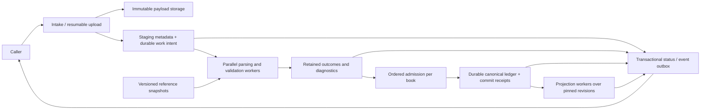

# Durable staged ingestion — proposed design

Status: design proposal, 2026-10-21. Based on merged main
`6dbf9da86bacf8d8a0f290c081a7da3c531114ed` (journal balances, PR #19).
This document defines the target design; implemented local behavior is identified below. The proposed wire contract is in
[the API specification](staged-ingestion-api.md).

Implementation progress: the optional [local host](../apps/ingestion-host/README.md)
now implements durable intake, leased background validation, retained record
outcomes/errors, immutable contexts/references, revalidation and atomic canonical
ledger admission. The optional compiled `luca::ingestion_sqlite` library owns native C++
execution and SQLite storage; workers call the exact financial core directly.
No interpreter or subprocess bridge is required. Direct C++ integration and native
CLI tools are the default; a shared reporting API and optional MCP adapter remain
planned, with HTTP/gRPC hosts deferred. Projection coverage and multi-node
adapters also remain open. See [integration direction](native-ingestion.md#integration-direction)
and [executed evidence](reviews/NATIVE_INGESTION_20261021.md).

## Outcome and boundary

A caller submits transaction bytes and receives a durable import receipt as soon
as storage has secured the bytes and the intent to process them. Parsing,
normalization, reference checks, lifecycle validation and projections happen
afterward. Invalid transactions remain available with their original evidence,
diagnostics and validation history. Independently valid transactions can advance.

Receipt is a storage guarantee. Validation is an interpretation under named
versions. Commitment is acceptance into authoritative financial history.
Projection progress is specific to a named report contract. None implies the
next has completed.

The existing `SourceRecord` identifies evidence but does not own raw bytes.
`LifecycleLedger::accept_batch` is in-memory, synchronous, strict, atomic on
domain rejection and not concurrently mutable. It remains the financial gate.
The current CSV trade adapter produces observations; its output must not be
silently promoted into ledger events. The initial transaction adapter proposed
here is separate and covers only the existing cash/equity lifecycle domain.

## Architecture



| Responsibility | Location | Constraint |
| --- | --- | --- |
| Exact values, event invariants, lifecycle rules, journal/report calculations | Existing financial libraries | Deterministic, explicit inputs; no database, clock, network or scheduler access. |
| Transaction parsing and normalization | Opt-in `libs/adapters` extension | Own parsed output; preserve source identity and offsets; malformed values are diagnostic results. |
| Staging/orchestration and durable reference runtime | Opt-in native `libs/ingestion`, exported as `luca::ingestion_sqlite` | Explicit optional storage/JSON/thread dependencies, isolated from financial-only targets. |
| Durable storage, leases, retries, admission coordination | Native optional component; reference CLI under `apps/ingestion-host` | All I/O/concurrency remains outside financial targets; no interpreter or process bridge. |
| CLI and optional MCP tools | Application adapters | Same receipts/outcomes as direct C++ APIs; no duplicated financial rules; MCP remains planned. |
| Production database/object store/queue bindings | Replaceable host adapters | Must pass the same durability, fencing and idempotency contract. |

The native component's current C++ API and exact dependency/build requirements
are documented in [the host guide](../apps/ingestion-host/README.md). General
storage-independent orchestration, reporting operations and MCP representations
remain future boundaries. The deferred HTTP proposal is not the next delivery
requirement. The existing umbrella target and `SourceRecord` ownership do not
change.

## Durable storage design

Recommend a bounded local reference host using SQLite WAL metadata and an
immutable payload directory. Route `(tenant_id, book_id)` to a single shard;
separate book shards may use separate databases and workers. A book initially
owns one lifecycle ledger containing its accounts. This avoids inventing a new
cross-ledger lifecycle rule or a global financial sequence. The host book binding
is explicit; `AccountId` does not become a chart-account or book identifier.

SQLite is an optional integration dependency, never a financial library
dependency. WAL permits concurrent readers and a writer but still has one writer
per database and requires same-host shared memory. This is a portable correctness
reference, not a claim of unlimited write scaling. A multi-node host can use a
transactional database and object store behind the same contracts. See
[SQLite WAL](https://sqlite.org/wal.html).

Use WAL with `synchronous=FULL`, verify settings rather than assuming them, and
document the filesystem/device durability model. Platform-specific durable
flushes, including macOS full-sync settings where needed, belong in the adapter.
`NORMAL` does not provide the intended power-loss durability guarantee in WAL;
see [SQLite synchronous](https://sqlite.org/pragma.html#pragma_synchronous).
Acknowledgement covers the configured durable storage failure domain; local disk
survival does not promise recovery from loss of that disk. Replicated durability
is a separate host profile and must finish before acknowledgement when selected.
The initial host enables WAL only with SQLite's WAL-reset fix (3.51.3+ or known
patched 3.50.7+/3.44.6+ release lines). Older runtimes use DELETE/EXTRA rollback
journaling and advertise that profile. This preserves local durability while
avoiding the documented [upstream race](https://sqlite.org/wal.html#walreset);
it does not claim the same reader/writer concurrency as WAL.

### Receipt transaction

1. Authorize tenant/book/source, validate the bounded request envelope, reserve
   capacity and stream bytes to temporary storage while computing SHA-256.
   No transaction-level parser or reference lookup is on this path.
2. Finalize immutable payload storage: flush the file, install it atomically,
   and durably flush required directory metadata. Object-store adapters need an
   equivalent verified immutable object/version and retention guarantee.
3. In one metadata transaction write the import, payload reference/hash/size,
   idempotency binding, initial status and parse work intent/outbox entry.
4. Commit durably, then return the receipt. A timeout after commit is resolved
   by retry with the same idempotency key, returning the same import identity.

The bytes must be owned or pinned under enforceable retention; a mutable URL
alone is insufficient. A crash between steps 2 and 3 can leave an orphan payload,
which is safe to collect only after excluding live sessions/receipts. A durable
receipt must never point to an object that an upload timeout collector can delete.

Receiving a huge body still costs transfer, hashing and durable writes. Measure
time from last body byte to receipt separately from total upload duration. An
upload-session response only promises durable upload progress, not receipt of a
complete staged import. Final import creation binds and freezes a complete upload.

### Logical durable records

| Record | Required durable content |
| --- | --- |
| Import | Tenant/book/source, immutable options, payload identity, receipt time, enumeration state, revision, progress counters, links to predecessor submissions. |
| Staged record | Stable import ordinal/ID, source evidence ID, exact byte locator/hash, normalized candidate if constructible, group and dependency identities. |
| Validation run | Immutable adapter/rule/reference/engine versions, input/group membership hash, ledger revision examined, deterministic outcome and diagnostics. |
| Diagnostic | Stable code, severity, scope, field/byte location, related IDs, structured details, retry/dependency classification. Human text is not an error code. |
| Work item / attempt | Unique task key, ready time, attempt number, lease owner/expiry, fencing generation and bounded failure history. |
| Admission group | Sealed membership, dependency heads, successful validation run, expected ledger revision, stable commitment identity and current operational state. |
| Canonical append / commit receipt | Existing canonical record bytes, local sequences/times, prior/new revision, source and validation links, group identity and fingerprint. |
| Status history / outbox | Monotone import revision, event identity/type, change references and delivery cursor; same transaction as the underlying state change. |
| Projection progress | Named projection/context/version and successfully published input revision; failures independent of ledger acceptance. |

Indexes support import/ordinal pages, work ready time, blocked dependency keys,
unique idempotency keys, unique commit identities and partition revisions. Do not
scan every import to discover ready work or resolve a single dependency arrival.
Counters and compact status update once per completed bounded batch, with records
and counters consistent in the same transaction. Detailed history is append-only;
current status is a derived/materialized view.

## State and validation design

Use separate axes rather than a single growing list of combined states:

| Axis | Values | Meaning |
| --- | --- | --- |
| Enumeration | `pending`, `running`, `complete`, `failed` | Whether all source record boundaries/group members are known. Unknown record totals remain null. |
| Validation, per record/group | `pending`, `running`, `valid`, `invalid`, `blocked` | A result under one explicit validation run. Invalid means deterministic input/rule failure; blocked means an unmet prerequisite. |
| Commitment, per group | `not_committed`, `queued`, `committed`, `conflict` | Durable ledger acceptance, independent of validation progress. |
| Work health | `idle`, `queued`, `running`, `retry_wait`, `attention_required` | Scheduling/infrastructure progress, independent of financial validity. |

There is no universal `projected` flag. Projection progress is a map keyed by the
full projection contract, including input revision, cutoffs, policy and version.
A committed event remains committed when a projector fails or a later reference
data version would interpret the source differently.
A valid cash/equity event can also be outside a narrow journal policy's supported
domain. Expose that projection limitation; do not relabel accepted economics as
invalid input or report unsupported accounting output as complete.

Each validation run pins the adapter, normalization/rules, engine and immutable
reference snapshot. Workers receive owned bounded inputs and explicit snapshots,
not borrowed references into a concurrently changing `LifecycleLedger`.

Validation stages:

1. Enumerate records and preserve raw locations. Parse failures produce retained
   import/record diagnostics; a completely unreadable file still has its receipt.
2. Parse/normalize independent records in parallel. Use existing exact value
   constructors; unsupported precision, overflow and invalid identifiers are
   explicit failures. Never use floating-point intermediate monetary values.
3. Seal atomic group membership and construct the dependency graph. Detect
   duplicate identities, cycles and conflicting successors deterministically.
4. Validate against explicit reference data and ledger snapshot. Missing account,
   instrument or causal predecessor can be `blocked`, with an indexed dependency
   key. Structurally inconsistent/unsupported data is `invalid`.
5. Produce immutable candidates/outcomes. Enqueue eligible groups for admission;
   recheck authoritative lifecycle preconditions at the commit boundary.

Order diagnostics by source ordinal, field path and stable code, independent of
worker completion order. Operational attempt IDs/times are not financial result
identity. No same-import dependency is admitted merely because its worker finished
first; sealed groups and accepted predecessor receipts determine eligibility.

Infrastructure exceptions/timeouts do not mark financial data invalid. Retry them
with bounded exponential backoff and jitter; after the configured attempt limit,
retain `attention_required` and the last durable business state. A process restart
reclaims expired work. Every result publication checks lease generation, current
run ID and group revision; stale workers cannot overwrite a newer result or commit.

New reference data does not silently rewrite a validation result. Dependency
arrival schedules a new run under a recorded snapshot; an explicit revalidation
can select another supported context. Keep all earlier diagnostics and versions.
Committed records cannot be revalidated into a replacement ledger effect.
Revalidation preserves adapter/normalization/identity/grouping semantics and sealed
membership. A change to those semantics requires a linked new submission.

## Atomicity, identity and ordering

### Atomicity modes

`independent_groups` is the default: independently valid groups commit even when
other groups are invalid/blocked. The adapter conservatively joins records with
same-import causal dependencies or a declared atomic group into one component.
Client grouping may enlarge atomicity, never split a known financial dependency.
One invalid member prevents its entire component from committing. Valid members
in a blocked component remain visibly valid but uncommitted.

`whole_import` commits all records once or none. It is bounded by the advertised
maximum atomic group size. Large files may use independent groups; the host must
not silently weaken a requested whole-import guarantee to fit a transaction.
When size can only be determined by parsing, retain an asynchronous group-limit
diagnostic and commit none of that group; do not retract the durable receipt.

Complete enumeration and group sealing precede promotion in v1. This prevents a
later row from changing the membership of an already committed atomic group.
Parsing/validation can overlap enumeration, but acceptance cannot outrun this
barrier. A malformed record with unknowable requested group membership blocks
sealing that import rather than guessing. Under independent mode a malformed row
without declared grouping is its own invalid record; unresolved causal references
from other records remain blocked. Cross-import prerequisites must be committed
first. Cross-book atomic groups/dependencies are unsupported in v1 and diagnosed.

### Idempotency and duplicate economics

Scope receipt idempotency by `(tenant, book, source, idempotency_key)`.
Fingerprint exact payload bytes plus a versioned canonical encoding of immutable
options; equivalent JSON metadata order must not change the fingerprint. Exclude
upload-session identity, timestamps and tracing headers. Bind the fingerprint and
import ID in a unique transaction. Same key/content returns the same receipt;
different content/options returns `409`. Hash equality is not a tenant boundary.

Retain the idempotency binding for the receipt lifetime; no invisible short TTL.
Document retention before accepting bytes. A new key is a new submission, even
for identical bytes: source evidence can legitimately be repeated. Do not dedupe
financial effects on payload hash alone. Canonical record/economic identities and
versioned source identity mapping still prevent a second origin. A source-native
transaction ID is mapped within source/book scope, not globally.

Commit identity is stable across task retries/revalidation:
`(tenant, book, import_id, sealed_group_id)`. Its candidate fingerprint is stored.
The same identity with different candidates is a conflict, never a new effect.

### Ordered admission and durable ledger

One admission owner per book serializes the final financial gate. Independent
books proceed in parallel; reference loading and record validation do not hold
the admission lock. Within a group, order parents before children with a stable
source-ordinal tie-break. Accepted ordering across independent racing groups is
the recorded durable admission order; it is not guaranteed to match a later
re-import under a different schedule. Replay of the persisted sequence is stable.

At admission, load/verify the expected book revision, check fencing/run/membership,
look up an existing commit receipt, then invoke the existing strict lifecycle
rules to prepare an owned accepted suffix without publishing mutation. A revision
race retries validation against the new revision. A genuine competing lifecycle
successor becomes a retained conflict diagnostic; it is not retried forever.
Reuse the parsed candidate and immutable reference results on a revision race;
repeat only ledger-dependent checks unless their declared inputs changed. Record
that admission check and its revision. An unrelated append must not force another
payload parse or remote reference fetch. Finer dependency-key revision checks can
be added only with explicit proof that they cover every lifecycle precondition.

The current mutating `accept_batch` does not expose this prepare/publish boundary
and copies/scans history indexes. Implementing the durable bridge may require a
small additive `prepare_acceptance` contract inside the ledger library, sharing
the existing validation implementation and preserving `accept_batch` behavior.
A prepared append owns accepted records and binds their sequences to the prior
ledger revision; it cannot be applied to another revision. Do not copy the entire
ledger for every group or duplicate lifecycle rules in the host. Group-commit
several eligible independent groups in bounded appends when their validation and
error-isolation contracts permit it. Measure preparation cost against increasing
history size; any remaining full-history work must be visible before performance
acceptance, rather than hidden behind a fast receipt.

Assign host `recorded_at` at successful admission using an explicitly supplied
monotone book clock: at least the previous accepted recorded time. Preserve
source-reported time and receipt time separately. Store chosen times and local
sequences in the commit; do not recompute them on replay. Economic `effective_at`
and supplied settlement dates retain their existing meanings. This host convention
does not redefine the library's caller-supplied recorded-time contract.

In one durable transaction append canonical records, advance book revision,
write the unique commit receipt, mark the group committed and write outbox work
for projections/status. Publish the in-memory state only after that transaction
commits. If it fails, discard/rebuild candidate state; do not leave an in-memory
ledger ahead of storage. Recovery rebuilds from durable accepted history and
verifies canonical values/order before serving that book.
If cache publication fails after durable commitment, suspend that book and rebuild
from its durable receipt/log; never report the commit as absent and append it again.

The durable store must record an append without serializing/hashing the entire
ledger on every commit. Reuse existing canonical record bytes. A host persistence
envelope records schema version, sequence, group boundaries and checksums; it is
not a replacement LCB1 format or evidence manifest. Full-ledger canonical export
continues to use the existing library format. A record-stream recovery decoder
may need an additive reviewed API; do not assume standalone-record decoding is
already exported. Checkpoint acceleration and incremental evidence remain separate
roadmap work; full replay is the correct initial recovery fallback.

For v1, staging metadata and canonical append/receipt must share this transaction
boundary. A later external ledger adapter is conforming only if it supplies a
durable idempotent commit command, queryable receipt and recoverable handoff.
Updating two independent databases and hoping both writes succeed is insufficient.
Workers/notifications are at-least-once; unique durable commit receipts prevent
duplicate ledger effects under that stated boundary.

## Small execution API, proposed

These are contract sketches, not compilable or released declarations:

```cpp
// Pure adapter/domain boundary; all data and versions supplied explicitly.
ParseBatchResult parse_batch(ByteRange bytes, ParseContext context);
ValidationBatchResult validate_batch(
    std::span<const OwnedCandidate> records,
    const ReferenceSnapshot& references,
    const OwnedLedgerSnapshot& ledger,
    const ValidationContext& context);

// Host boundary; implementations perform I/O.
expected<ImportReceipt, IntakeFailure> receive(Submission, PayloadReader&);
expected<WorkLease, StoreFailure> claim_work(WorkerIdentity, Limits);
expected<PublishReceipt, StoreFailure> publish_outcome(
    WorkLease, RunIdentity, GroupRevision, OwnedValidationResult);
expected<CommitReceipt, AdmissionFailure> commit_group(
    WorkLease, SealedGroup, ValidationRunId, ExpectedBookRevision);
ImportSnapshot read_import(ImportId, PageRequest);
```

`ParseBatchResult`/`ValidationBatchResult` contain successful values, invalid
outcomes and blocked outcomes together. They do not reject a whole batch merely
because one row is bad. Typed candidate constructors and lifecycle acceptance
still return their existing errors. Cancellation, leases, clocks and retries
never become implicit dependencies of arithmetic functions. Storage operations
return owned results and check fencing transactionally; method names alone do
not establish those guarantees. A fake in-memory adapter can test orchestration,
but cannot demonstrate durability acceptance.

## Reporting, notifications and retention

Reports select a pinned accepted revision vector across requested books, complete
time cutoffs and engine/policy/projection/reference identities. They do not read
staged candidates as if committed. Return coverage captured with that selection:
imports included, excluded invalid/blocked/pending counts, enumeration completeness,
required partitions and per-projection readiness. Capture related status and ledger
revisions consistently per shard; do not join live counters onto an older report.
Independent books form an explicit revision vector, not a fabricated global sequence.

An `available` report can disclose omissions. A `require_imports` request names
specific imports and waits/fails explicitly until all required groups have committed
and the requested projection reaches those revisions. Invalid input cannot satisfy
that barrier. A complete report over committed history is not a claim that every
external transaction has been delivered. Full report endpoint design belongs to
the reporting checkpoint; ingestion must expose enough receipts for that boundary.

Status/outbox events are durable, replayable and at-least-once. Order within each
import uses its revision; there is no cross-book event order. Delivery failure
does not undo commitment. Polling is the required v1 interface; SSE/webhooks are
optional later adapters over the same event log, not a second status authority.

Original bytes, status transitions, validation runs and commit links are retained
under the host's declared policy, including invalid imports. No automatic purge
is enabled in the first reference host and there is no public delete API in v1.
Future retention/deletion must preserve required evidence or an explicit retention
tombstone and idempotency binding. Enforce tenant/book access on every retrieval;
do not put raw sensitive field values in notifications or general operational logs.

## Performance and resource contracts

Batch work by bytes/record count with bounded memory. Preload reference snapshots,
reuse parse/normalization output and schedule only affected dependency keys.
Separate intake, validation/admission and report CPU/I/O budgets; apply per-tenant
fairness so one huge import cannot starve smaller ones. Reserve durable capacity
before receiving bytes. Use explicit limits and `429`/`503` rather than acknowledging
work that cannot be retained. Already receipted work remains recoverable during
backpressure. Report backlog age and drain rate, not just worker activity.

Parallelism is permitted for disjoint record parsing/validation and separate book
admission. Lifecycle chains retain order. This design makes no new algebraic merge
claim. Shared preparation, incremental evidence, multicore report execution and
optional GPU experiments remain their explicit roadmap checkpoints. Storage
separation alone does not guarantee performance; the admission path may expose
existing full-history core costs that require a measured follow-up.

Benchmark 10k/100k/1m records, many small books and one concentrated book, malformed
and blocked records, long correction chains, disk pressure, concurrent reporting,
worker death and restart. Measure upload and post-upload receipt p50/p95/p99,
parse/validation/commit rates, queue age/drain time, projection lag, recovery time,
memory per record, durable bytes and 1/2/4/8-worker efficiency. Include flushes,
diagnostics/evidence and output materialization. Publish reference hardware and
data shapes. Set numerical service budgets from that first baseline before
performance acceptance; no latency or Geneva speedup is claimed by this proposal.

## Delivery and acceptance gates

1. **Durable intake:** implement receipt/idempotency, immutable bytes, resumable
   transfer and durable work intent. Prove restart and retry behavior before
   adding admission. The user has resumed tests and benchmarks.
2. **Validation/status:** implement the narrow JSONL transaction adapter,
   versioned outcomes, diagnostics, dependency/group sealing, fencing and polling.
3. **Admission:** implement canonical append storage and atomic commit receipts,
   strict lifecycle integration and recovery. Prove sequential/parallel validation
   produces the same candidates/outcomes for pinned contexts; replay persisted
   acceptance order through existing projections and trial-balance controls.
4. **Coverage/performance:** expose revision/projection coverage, run concurrent
   workloads, establish budgets and record limits. This completes staging only
   after its failure and load criteria pass; report/evidence checkpoints remain.

Required fault cases: crash before payload finalization; after payload but before
receipt; after receipt before response; during validation; after lease expiry;
before/after atomic ledger commit; before event delivery; before projection
publication. Verify acknowledged bytes/work survive, retries preserve identity,
stale workers cannot publish, no duplicate effects occur, and diagnostics persist.
Test same-key conflicts, source identity collisions, invalid-neighbor progress,
whole-import rejection, malformed group membership, missing dependency arrival,
competing corrections, reference-version changes and bounded queues/pages. Include
process-kill tests and adapter durability checks; process restart alone is not a
power-loss test. Backup/restore must recover matching payload, staging and ledger
revisions before a host profile is called recoverable.

The recommended initial choices are automatic promotion of valid independent
groups, one admission stream per book, a local SQLite/blob reference host, and
polling with a durable event cursor. Distributed transport, manual promotion,
cross-book transactions and GPU validation are outside this first increment.
